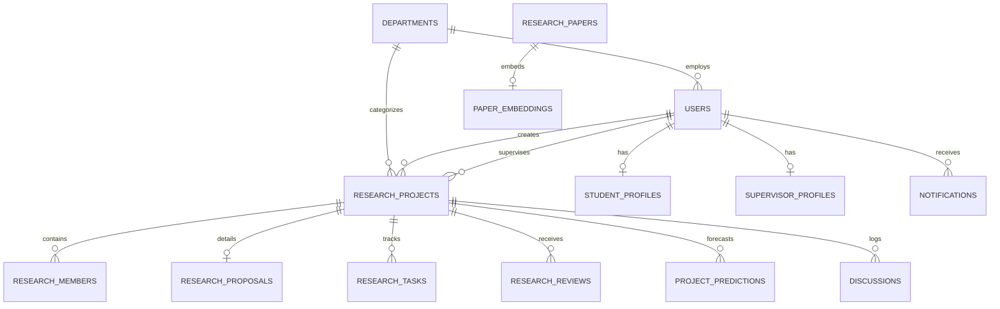

# SOFTWARE REQUIREMENTS SPECIFICATION (SRS)
## Project Title: ResearchHub AI — Intelligent University Research Management & Recommendation Platform
**Document Version:** 1.0.0  
**Standard:** IEEE Std 830-1998 Compliant  
**Academic Degree:** B.Sc. / M.Sc. in Computer Science and Engineering  
**Department:** Department of Computer Science & Engineering  

---

### 1. Introduction

#### 1.1 Purpose
This Software Requirements Specification (SRS) document details the functional, non-functional, interface, and behavioral requirements of **ResearchHub AI**. ResearchHub AI is a web-based, machine learning-driven university research lifecycle management platform designed to support students, researchers, faculty supervisors, and university administrators throughout all phases of academic research.

#### 1.2 Scope
ResearchHub AI provides:
1. Machine Learning-based Research Topic Recommendations aligned with student skills and departmental domains.
2. Vector-based Semantic Academic Paper Search & Recommendation.
3. Natural Language Processing (NLP) Research Gap Identification Assistant.
4. Automated 6-section PDF & Research Document Summarization.
5. Random Forest Machine Learning Progress & Deadline Risk Prediction.
6. Algorithmic Research Methodology & Architecture Recommendation.
7. Centralized Project Workspace, Proposal Evaluation, and Milestone Kanban.
8. Role-Based Access Control (RBAC) supporting four user tiers: Student/Researcher, Faculty Supervisor, Department Administrator, and Super Administrator.

#### 1.3 Definitions, Acronyms, and Abbreviations
- **SRS:** Software Requirements Specification
- **PRD:** Product Requirements Document
- **NLP:** Natural Language Processing
- **TF-IDF:** Term Frequency-Inverse Document Frequency
- **FAISS:** Facebook AI Similarity Search
- **RAG:** Retrieval-Augmented Generation
- **RBAC:** Role-Based Access Control
- **REST:** Representational State Transfer
- **JSON:** JavaScript Object Notation
- **WAL:** Write-Ahead Logging
- **mAP:** Mean Average Precision
- **AUROC:** Area Under the Receiver Operating Characteristic Curve

---

### 2. Overall Description

#### 2.1 Product Perspective
ResearchHub AI operates as a decoupled, multi-tiered web platform. The presentation layer is an intuitive, responsive Single Page Application (SPA), communicating with a high-performance Python FastAPI REST backend. Machine learning engines interface directly with persistent relational databases (SQLite / PostgreSQL schema) and document stores.

```
+-------------------------------------------------------------+
|                      PRESENTATION TIER                      |
|   Responsive SPA (HTML5, Tailwind CSS, Lucide Icons, JS)    |
|   Student · Supervisor · Department Admin · Super Admin     |
+------------------------------+------------------------------+
                               | REST APIs / JSON
+------------------------------v------------------------------+
|                        BACKEND API                          |
|         FastAPI REST Gateway · Security · Routing           |
+------------------------------+------------------------------+
                               |
       +-----------------------+-----------------------+
       |                                               |
+------v-----------------------+     +-----------------v------+
|     MACHINE LEARNING ENGINES |     |     DATABASE STORAGE   |
| • Topic Recommender (TF-IDF) |     | • PostgreSQL / SQLite  |
| • Vector Paper Search (FAISS)|     |   Users, Projects,     |
| • Gap Assistant (Clustering) |     |   Tasks, Reviews,      |
| • PDF Summarizer (NLP Rank)  |     |   Proposals, Papers    |
| • Progress Predictor (RF)    |     +------------------------+
| • Methodology Advisor        |
+------------------------------+
```

#### 2.2 User Classes and Characteristics
1. **Student / Researcher:**
   - Final-year undergraduate or graduate student.
   - Core needs: Discover feasible topics, find literature, identify novel research gaps, organize milestones, submit proposals, receive supervisor feedback.
2. **Teacher / Research Supervisor:**
   - Faculty member, thesis advisor, or principal investigator.
   - Core needs: Review project proposals, assign ratings and action items, track student progress, inspect machine learning deadline risk alerts.
3. **Department Administrator:**
   - Department head, academic committee chair, or postgraduate coordinator.
   - Core needs: Monitor department-wide project counts, verify supervisor quotas, export research audits.
4. **Super Administrator:**
   - Dean of Graduate Studies or institutional IT administrator.
   - Core needs: Manage institutional departments, user authorization roles, and system-wide configurations.

---

### 3. System Features & Functional Requirements

#### 3.1 Authentication & Role-Based Access Control (RBAC)
- **FR-AUTH-1:** The system shall support secure registration and login using SHA-256 salted password hashing.
- **FR-AUTH-2:** The system shall enforce role-based permission boundaries across Student, Supervisor, Dept Admin, and Super Admin.
- **FR-AUTH-3:** The system shall provide an instant role-switching utility for demonstration, validation, and administrative auditing.

#### 3.2 AI Research Topic Recommendation Engine
- **FR-ML-TOPIC-1:** The system shall accept research field, interest keywords, and student technical skills as input.
- **FR-ML-TOPIC-2:** The engine shall calculate semantic cosine similarity between user queries and a curated academic research topics corpus.
- **FR-ML-TOPIC-3:** The engine shall apply skill synergy boosting to reward topic proposals matching student proficiencies.
- **FR-ML-TOPIC-4:** Output shall include confidence score (%), difficulty level, rationale, suggested datasets, and sample methodologies.

#### 3.3 Semantic Paper Search & Recommendation Engine
- **FR-ML-PAPER-1:** The system shall index research papers using dense TF-IDF and n-gram vector representations.
- **FR-ML-PAPER-2:** The system shall perform nearest-neighbor cosine similarity queries against the catalog.
- **FR-ML-PAPER-3:** The system shall recommend similar papers based on title and abstract embeddings for any selected paper.

#### 3.4 Research Gap Identification Assistant
- **FR-ML-GAP-1:** The system shall cross-reference research topics and keywords against documented literature limitations.
- **FR-ML-GAP-2:** Output candidate gaps across four distinct categories:
  1. Methodological & Computational Gaps
  2. Data & Domain Generalization Gaps
  3. Real-World & Edge Deployment Gaps
  4. Evaluation & Benchmark Gaps
- **FR-ML-GAP-3:** Each gap shall provide an actionable experimental direction and feasibility rating for university thesis timelines.

#### 3.5 PDF & Research Document Summarization
- **FR-ML-SUMM-1:** The system shall accept uploaded PDF, TXT, or pasted academic text.
- **FR-ML-SUMM-2:** The extraction pipeline shall decompress and parse raw stream tokens into clean sentence buffers.
- **FR-ML-SUMM-3:** The summarization engine shall automatically generate 6 structured sections:
  1. Executive Abstract Summary
  2. Research Objectives
  3. Proposed Methodology
  4. Experimental Results & Metrics
  5. Recognized Limitations
  6. Future Research Work

#### 3.6 Machine Learning Progress & Deadline Risk Predictor
- **FR-ML-RISK-1:** The system shall extract project metrics: completed tasks ratio, elapsed timeline ratio, overdue count, team velocity, and supervisor reviews count.
- **FR-ML-RISK-2:** A trained `RandomForestClassifier` (100 estimators) shall classify project risk into:
  - `ON_TRACK`
  - `MODERATE_RISK`
  - `CRITICAL_RISK`
- **FR-ML-RISK-3:** The prediction response shall output:
  - Risk percentage (0.0% to 100.0%)
  - On-time completion probability (%)
  - Projected schedule delay in days
  - Diagnosed risk factors
  - Actionable mitigations
  - Model feature importance weights

#### 3.7 Research Methodology Recommender
- **FR-ML-METH-1:** The system shall evaluate research questions, data modalities (images, text, tabular, time-series, graph), and hardware constraints.
- **FR-ML-METH-2:** The engine shall recommend the optimal architecture (e.g., YOLOv8, Vision Transformer, nnU-Net, DeBERTa, GAT, XGBoost).
- **FR-ML-METH-3:** Output shall provide a 5-step engineering pipeline, alternative baselines, metrics, and starter code frameworks.

#### 3.8 Project Workspace, Proposals & Milestone Kanban
- **FR-WORK-1:** Users shall create and manage research proposals with problem statements, objectives, methodology, and budgets.
- **FR-WORK-2:** Supervisors shall submit numeric scores (0-100), feedback commentary, and action items.
- **FR-WORK-3:** The system shall provide an interactive Kanban board with 4 milestone states: `todo`, `in_progress`, `review`, and `completed`.
- **FR-WORK-4:** Real-time discussion threads between students and supervisors shall be persisted.

---

### 4. Non-Functional Requirements (NFR)

#### 4.1 Performance & Scalability
- **NFR-PERF-1:** REST API responses for project listings and Kanban updates shall execute in under 120ms.
- **NFR-PERF-2:** ML topic and methodology recommendation queries shall return within 350ms.
- **NFR-PERF-3:** Database operations shall utilize SQLite WAL (Write-Ahead Logging) mode supporting concurrent reads without blocking writes.

#### 4.2 Security & Integrity
- **NFR-SEC-1:** Passwords shall never be stored in plaintext; all user credentials must pass through salted SHA-256 cryptographic hashing.
- **NFR-SEC-2:** SQL injection prevention: 100% of database queries must use parameterized prepared statements.
- **NFR-SEC-3:** File uploads shall restrict extensions to academic formats (.pdf, .txt, .docx) with sanitized server-side filenames.

#### 4.3 Reliability & Availability
- **NFR-REL-1:** The platform shall support offline and standalone deployment without requiring cloud internet access.
- **NFR-REL-2:** Automated database schema migration and dataset seeding shall occur seamlessly on application initialization.

---

### 5. Database Schema Specifications



*(Refer to `backend/app/database.py` for exact SQL DDL definitions)*

